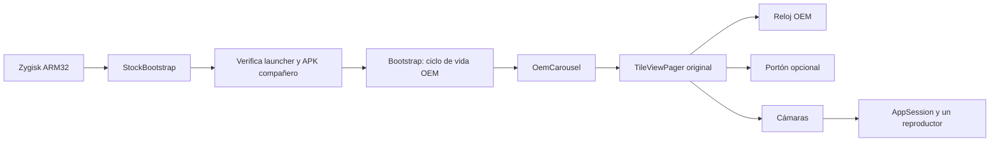

# Integración con el carrusel original

## Plataforma compatible

Esta integración está fijada al Xiaomi Mi Smart Clock **X04G**, Android 10/API 29, proceso ARM de 32 bits y pantalla de 800×480. Verifica en tu equipo:

| Elemento | Valor requerido |
| --- | --- |
| APK del launcher | `/product/app/com.google.assistant.launcher/app.apk` |
| Paquete | `com.google.assistant.launcher` |
| Versión | `11.51.6.416171605`, versionCode `111706` |
| SHA-256 del APK | `1e5b52f356ef7c078619dc369cccf704060aca484754cef454fa921598ed8c21` |
| Proceso | `com.google.android.apps.mediashell` |
| Activity | `com.google.assistant.surfaces.clock.launcher.AssistantLauncherActivity` |
| Arranque | Magisk 26+ con Zygisk API 4 habilitado |

Las comprobaciones de versión, firma, ruta y hash son deliberadas. Otro firmware necesita analizar y adaptar sus clases. Cambiar sólo un hash para eludir la validación no establece compatibilidad.

## Cómo se incorporan las páginas



El módulo nativo sólo selecciona el nombre de proceso indicado y el UID leído de `uid.pin`. Carga un DEX acotado con `InMemoryDexClassLoader` y descarga su biblioteca nativa; no instala hooks PLT/JNI permanentes. El DEX combina el puente Java y el código de la app, compilados para la misma pareja.

`StockBootstrap` espera a Looper y Application antes de comprobar el sistema y el APK compañero. `Bootstrap` registra callbacks de Activity. En el hilo principal, `OemCarousel` localiza el fragmento Home `cat`, adaptador `zb`, modelo `cbg`, `TileViewPager` y `CastWindowFragmentRegistry`. Comprueba sus enlaces y colecciones antes de añadir fragmentos Android con identificadores propios y modelos de tipo 8. Su observador mantiene Portón y Cámaras inmediatamente después del modelo de reloj de tipo 0, conservando los demás modelos OEM y la selección.

El pager sigue siendo el original. Las vistas propias arbitran el toque con ese padre: el zoom retiene arrastres interiores y los bordes permiten navegar. El selector y los editores son modales. La visibilidad real, foco, lifecycle y posición del pager controlan cuándo hay vídeo. `CameraIdleLease` evita el retorno automático al reloj únicamente mientras la cámara o su editor están activos; libera esa excepción al salir.

La integración no modifica ni vuelve a firmar el APK OEM. Las fuentes e iconos se leen de tu copia del launcher, y el reloj, alarmas, menús, ajustes, barras y brillo automático continúan en el sistema original. Instalar el APK compañero por sí solo no añade las páginas.

## Recursos visuales locales

La app intenta leer las tres fuentes directamente del `AssetManager` del launcher
instalado. La release pública no las empaqueta: `--public-release` excluye tanto
`app/assets/fonts` como `.local/oem-fonts`, incluso si existen en el PC de quien
compila. Si faltan en el reloj, usa sans-serif y seis iconos vectoriales originales.

Para una compilación privada también puedes extraerlas de tu propio APK:

```powershell
adb -P 5142 -s SERIAL_DEL_RELOJ pull /product/app/com.google.assistant.launcher/app.apk .local/launcher.apk
python integration/extract_oem_fonts.py --launcher-apk .local/launcher.apk
python scripts/build_app.py
```

El extractor comprueba el hash y copia en `.local/oem-fonts`:

| Entrada en el APK original | Nombre usado por la app |
| --- | --- |
| `assets/dart_app.assets/GoogleSans-Regular.nohints.ttf` | `GoogleSans-Regular.ttf` |
| `assets/dart_app.assets/GoogleSans-Medium.nohints.ttf` | `GoogleSans-Medium.ttf` |
| `assets/dart_app.assets/googlematerialicons/GoogleMaterialIcons-Regular.otf` | `GoogleMaterialIcons-Regular.otf` |

No publiques tu APK de sistema, imágenes de particiones ni recursos propietarios extraídos.

## Compilar la pareja APK y módulo

Compila el APK primero. El módulo fija su hash, certificado de firma, longitud y DEX. Cada cambio del APK requiere construir e instalar de nuevo la pareja; un módulo antiguo rechaza un APK nuevo.

La compilación del APK utiliza herramientas Windows. Desde PowerShell, ejecuta:

```powershell
python scripts/build_app.py
```

Para distribuir los binarios, usa `python scripts/build_app.py --public-release`.
Después de construir el módulo, ejecuta `python scripts/verify_release.py` para
comprobar la pareja, las licencias y la ausencia de recursos OEM y rutas personales.

La compilación nativa del módulo se hace después en Linux x86_64 o WSL, desde la misma carpeta del repositorio, con Java 17/21 nativo y Android NDK **r20b/20.1.5948944**. Descomprime el [NDK Linux oficial](https://dl.google.com/android/repository/android-ndk-r20b-linux-x86_64.zip) en el filesystem Linux, por ejemplo `~/x04g-tools`; el sysroot contiene nombres que sólo se distinguen por mayúsculas y no debe extraerse en un NTFS que ignore esa diferencia. Su tamaño y SHA-256 están en `tools/integration-dependencies.json`. Comprueba el archivo descargado antes de extraerlo:

```bash
echo '8381c440fe61fcbb01e209211ac01b519cd6adf51ab1c2281d5daad6ca4c8c8c  android-ndk-r20b-linux-x86_64.zip' | sha256sum -c -
unzip android-ndk-r20b-linux-x86_64.zip -d ~/x04g-tools
python3 integration/build_module.py --ndk /ruta/android-ndk-r20b
```

Los resultados son `build/app/x04g-home.apk` y `build/integration/x04g-camera-carousel-disabled.zip`. El ZIP se genera deshabilitado y sin `uid.pin`. No contiene claves de firma, credenciales, datos de cámaras ni archivos de sistema. El build no ejecuta ADB ni toca hardware.

## Instalar y activar

Completa antes [el acceso ADB y Magisk](adb.md). Usa siempre el serial explícito, para no instalar por error en un emulador o teléfono conectado. Comprueba el launcher:

```powershell
adb -P 5142 -s SERIAL_DEL_RELOJ shell sha256sum /product/app/com.google.assistant.launcher/app.apk
adb -P 5142 -s SERIAL_DEL_RELOJ shell dumpsys package com.google.assistant.launcher
adb -P 5142 -s SERIAL_DEL_RELOJ shell su -c id
```

El hash y versión deben coincidir con la tabla; `su -c id` debe mostrar `uid=0`. Obtén el `userId` real del paquete en `dumpsys`; no copies el UID de otra unidad.

```powershell
adb -P 5142 -s SERIAL_DEL_RELOJ install -r build/app/x04g-home.apk
adb -P 5142 -s SERIAL_DEL_RELOJ push build/integration/x04g-camera-carousel-disabled.zip /data/local/tmp/x04g-camera-carousel-disabled.zip
adb -P 5142 -s SERIAL_DEL_RELOJ shell su -c 'magisk --install-module /data/local/tmp/x04g-camera-carousel-disabled.zip'
```

Tras la instalación, entra en una shell interactiva para evitar diferencias de comillas entre terminales:

```text
adb -P 5142 -s SERIAL_DEL_RELOJ shell
su
cmd package list packages -U com.google.assistant.launcher
```

Identifica el número de UID entre 10000 y 19999. Sustituye `UID_OEM` en el comando siguiente por ese número exacto:

```sh
printf '%s\n' UID_OEM > /data/adb/modules_update/x04g_home_bootstrap_direct01/uid.pin
chown 0:0 /data/adb/modules_update/x04g_home_bootstrap_direct01/uid.pin
chmod 0600 /data/adb/modules_update/x04g_home_bootstrap_direct01/uid.pin
```

El archivo debe tener cinco dígitos y un salto de línea opcional, propietario root:root y no ser escribible por grupo/otros. La instalación por CLI en Android se prepara en `modules_update`; Magisk la traslada a `modules` durante el reinicio. Por eso el pin y la activación deben escribirse en la carpeta preparada. Antes de activar, comprueba que el APK y ZIP corresponden a los hashes de sus `build-report.json`, Zygisk está habilitado y el proceso objetivo no está en DenyList. Conserva la pareja anterior si actualizas.

```sh
rm /data/adb/modules_update/x04g_home_bootstrap_direct01/disable
reboot
```

El arranque muestra la hora OEM. Desliza a las páginas nuevas y configura una cámara en **Administrar**. El reproductor arranca sólo al entrar en Cámaras. No se copia configuración de ejemplo automáticamente.

## Diagnóstico y retirada

```powershell
adb -P 5142 -s SERIAL_DEL_RELOJ logcat -d -s X04GBootstrap X04GRuntime
adb -P 5142 -s SERIAL_DEL_RELOJ shell getenforce
```

Busca `state=INSTALLED` en el JSON de `X04GRuntime` o `stage=app_bootstrap result=dispatched`, seguido del estado real del carrusel. El dispatch por sí solo no demuestra que las páginas estén instaladas. Una cámara debe entregar imagen visible; una respuesta RTSP o un socket abierto no basta.

Para retirar la extensión, crea de nuevo `disable` desde una shell root y reinicia:

```sh
touch /data/adb/modules/x04g_home_bootstrap_direct01/disable
reboot
```

Esto desactiva las páginas sin restaurar ni sustituir el launcher. Puedes desinstalar `org.x04g.home` después de desactivar el módulo. No borres los datos del launcher OEM para retirar la extensión. Si no puedes obtener una shell al arrancar, usa la vía de recuperación y el respaldo descritos en la guía ADB.
