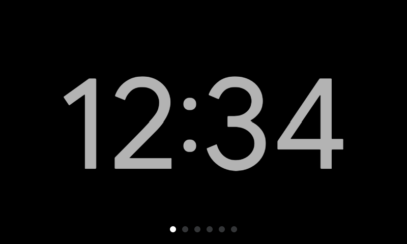
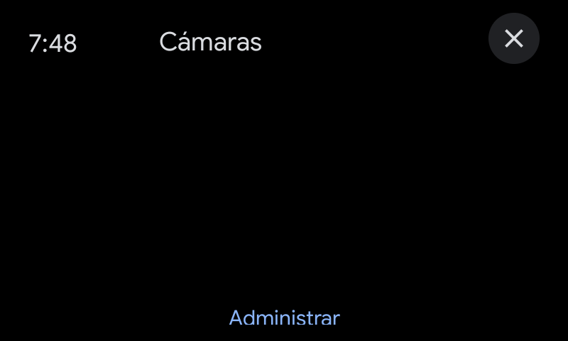
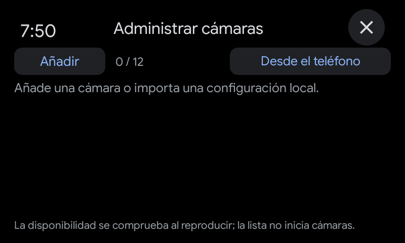
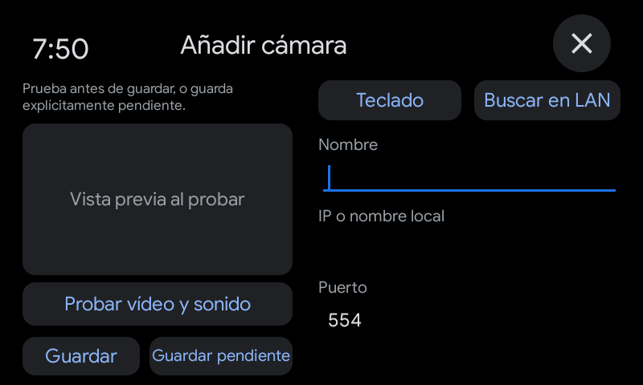
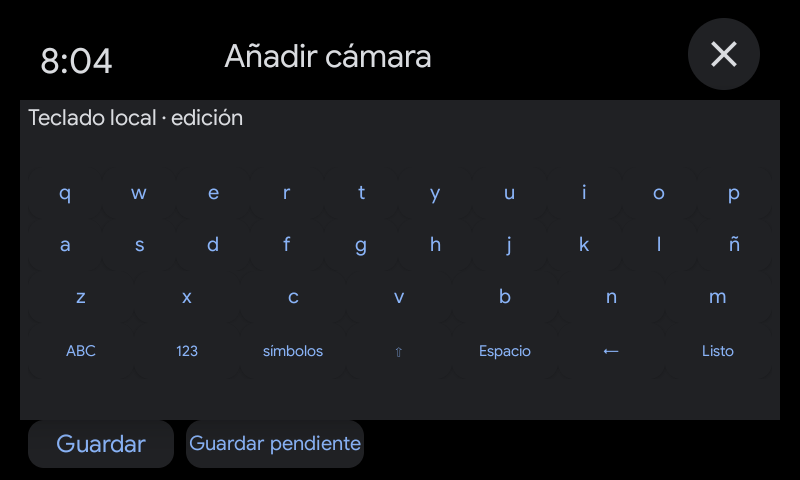
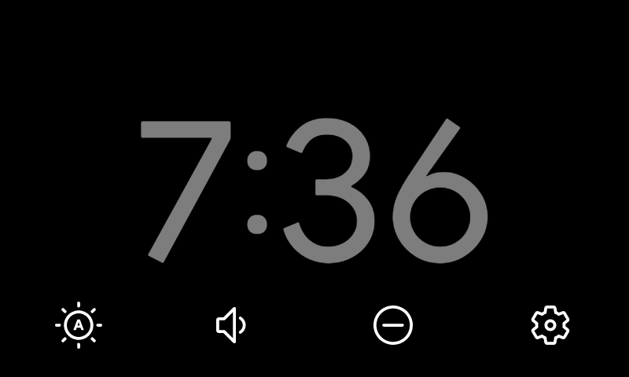

# Capturas de la integración

Capturas reales de 800 × 480 píxeles. No contienen imágenes de cámaras privadas,
credenciales ni configuraciones personales. Las pantallas del emulador se
identifican expresamente; no equivalen a una prueba de hardware.

## Reloj original

Reloj original en un X04G con las páginas de la extensión incorporadas al
carrusel. Sus indicadores pertenecen al pager OEM.

## Página de cámaras

Vista integrada en el proceso del launcher OEM dentro del emulador. La página
vacía invita a configurar una cámara; no representa un stream en reproducción.

## Selector por pulsación prolongada

## Administración

La lista, el editor y el teclado corresponden al APK incluido, ejecutado dentro
del launcher emulado. No hay contraseñas, direcciones ni cámaras particulares.

## Accesos originales

La bandeja pertenece al sistema original ejecutado en el PC. El entorno de
laboratorio adapta el hardware virtual y la entrada al launcher; no acredita
el aprovisionamiento de Google Home ni la reproducción audiovisual del reloj.

Las imágenes conservan los píxeles capturados. Sus dimensiones, origen y hashes
se registran en [screenshots.json](screenshots.json).
